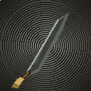

# Hunter's Greatsword (Gran Espada del Cazador)

Mod para **Minecraft 1.21.1 Forge** que añade una gran espada a dos manos al estilo Monster Hunter, animada por completo con **GeckoLib**.



## Requisitos

| Componente | Versión |
| --- | --- |
| Minecraft | 1.21.1 |
| Minecraft Forge | 52.1.0 o superior |
| GeckoLib | 4.7.x para Forge 1.21.1 (no viene incluido) |
| Java | 21 |

## Instalación

1. Instala Minecraft Forge 1.21.1.
2. Descarga GeckoLib 4.7.x para Forge 1.21.1 y colócalo en la carpeta `mods`.
3. Coloca `greatsword-2.0.0.jar` en la carpeta `mods`.
4. Inicia el juego.

## Cómo conseguirla

- Receta de forja:

  ```
  lingote de hierro | bloque de hierro | lingote de hierro
  lingote de hierro | bloque de hierro | lingote de hierro
                    |      palo        |
  ```

- También aparece en la pestaña creativa **Hunter's Greatsword**.
- O usa `/give @p greatsword:greatsword`.

## Controles

| Acción | Control |
| --- | --- |
| Desenfundar / enfundar | `Z` |
| Desenvaine rápido | Clic derecho con la espada enfundada |
| Combo de 3 golpes | Clic izquierdo con la espada desenfundada |
| Golpe cargado | Mantén clic derecho y suelta para descargar |
| Embestida con el hombro | `V` |
| Bloquear la mano secundaria | Automático mientras está desenfundada |

- El primer clic izquierdo estando enfundada desenvaina la espada.
- El combo encadena tres golpes; el tercero es un giro de 180° que golpea a todo lo que rodea al jugador.
- El golpe cargado alcanza el daño máximo tras 1,5 segundos (30 ticks).
- La espada se dibuja enfundada en la espalda. Si la guardas o la cambias de mano, se enfunda sola.
- Mientras está desenfundada, la pose de **tercera persona** usa las dos manos y la mano secundaria queda bloqueada.
- La primera persona muestra el arma desde la mano principal; la pose a dos manos está pensada para la vista en tercera persona.
- El daño escala con el atributo de ataque del jugador (incluye pociones de Fuerza) y con encantamientos como Filo, Golpeo, Aspecto Ígneo, etc.
- Tiene 2031 de durabilidad y se repara con lingotes de hierro, como el equipo de hierro.

## Compilar

```bash
./gradlew build
```

El JAR se genera en `build/libs/greatsword-2.0.0.jar`.

En Windows:

```powershell
.\gradlew.bat build
```

## Desarrollo

- `tools/generate_assets.py` regenera el modelo, la textura y las animaciones.
- `tools/validate_assets.py` comprueba el formato del modelo y de las animaciones.
- `tools/preview.html` permite previsualizar el modelo en el navegador.
- El flujo de GitHub Actions (`.github/workflows/build.yml`) compila el mod y publica el JAR como artefacto.

## Tecnología

- GeckoLib 4.7.7 para el modelo 3D, los huesos y las diez animaciones.
- Un mixin de cliente para la pose a dos manos en tercera persona.
- Modelo, textura y animaciones generados con `tools/generate_assets.py`.

## Créditos

- Código, modelo y texturas: stormutowa.
- GeckoLib: bernie-g y colaboradores.
- Inspirado en las gran espadas de Monster Hunter.

## Licencia

All Rights Reserved. Consulta `LICENSE.txt`.
